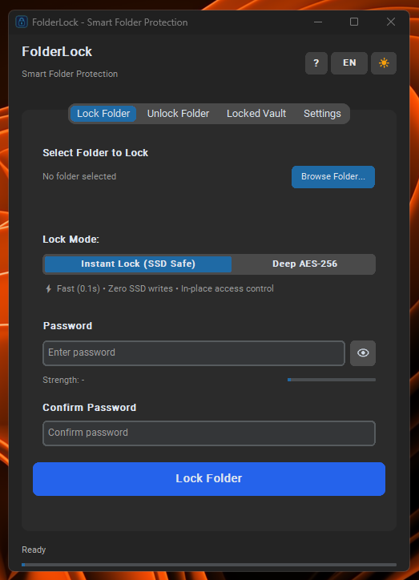

# FolderLock 🔒

A lightweight Windows app for locking folders quickly or protecting their contents with AES-256-GCM encryption. Available in English and Turkish.

**[Download the latest release](https://github.com/canyrtcn/FolderLock/releases/latest)** · [Usage & troubleshooting](docs/usage.md) · [Development](docs/development.md) · [Release notes](docs/releases/)

<p align="center">
  
</p>

## Download and run

1. Download `FolderLock.exe` or the portable ZIP from [Releases](https://github.com/canyrtcn/FolderLock/releases/latest).
2. Put the executable or extracted portable folder in a permanent location, then run `FolderLock.exe`.
3. Select a folder, choose a protection mode, enter your password, and click **Lock Folder**.

**Windows 10 / Windows 11.** No Python installation is needed for the released EXE. Release downloads include `SHA256SUMS.txt` for checking file hashes.

## Choose a protection mode

| Mode | What it does | Best suited to |
| --- | --- | --- |
| **Instant Lock** | Moves entries into a protected container and applies Windows NTFS access restrictions without rewriting file contents. | Fast local privacy for large folders and media. |
| **Deep AES-256** | Encrypts file contents into an authenticated AES-256-GCM vault. | Files that need cryptographic protection. |

Instant Lock is access control, not encryption: an administrator or offline storage access may bypass it. Keep independent backups of important files. The project has not been presented as independently security-audited.

## Unlock and re-lock

- Use the app's **Unlock Folder** tab, or double-click **FolderLock - Unlock** inside a protected folder.
- Double-click **FolderLock - Lock** to re-lock with saved settings, or choose new settings in the app.
- Enable Explorer integration in **Settings** to access FolderLock from a folder's right-click menu.

In-folder shortcuts reference the central executable. After moving the app, run it once to refresh an existing Explorer registration. Keep the original executable path available for existing in-folder shortcuts.

## What's new in v1.0.8

Instant Lock no longer rewrites a growing journal for each file. In a synthetic 1,036-file test with an open shared reader, lock time fell from about **12.2 seconds to 0.8 seconds**, and cumulative journal JSON writes fell from **332.7 MiB to 2.3 KiB**. Actual timings depend on storage and background activity. [Read the release notes](docs/releases/v1.0.8.md).

## Türkçe hızlı başlangıç

1. [Son sürümü indirin](https://github.com/canyrtcn/FolderLock/releases/latest) ve `FolderLock.exe` dosyasını açın.
2. **Klasör Seç** ile klasörünüzü belirleyin, kilit modunu seçip parolanızı girin.
3. **Klasörü Kilitle** düğmesine basın. Kilidi açmak için **Kilit Aç** sekmesini veya klasördeki **FolderLock - Unlock** kısayolunu kullanın.
4. Aynı ayarlarla yeniden kilitlemek için **FolderLock - Lock** kısayolunu kullanın.

**Hızlı Kilit** dosya içeriğini şifrelemez; Windows erişim izinleri uygular. **Tam AES-256** dosya içeriğini şifreler. [Kullanım, hata giderme ve kurtarma](docs/usage.md).

## Repository layout

```text
src/          Application source code
assets/       App icon and screenshot
packaging/    Windows build settings and build dependencies
tests/        Synthetic filesystem, encryption, CLI and integration tests
docs/         Usage, development guide and release notes
```

To run from source: `pip install -r requirements.txt`, then `python src/main.py`. Build and test instructions are in the [development guide](docs/development.md).

## License

[MIT](LICENSE).
